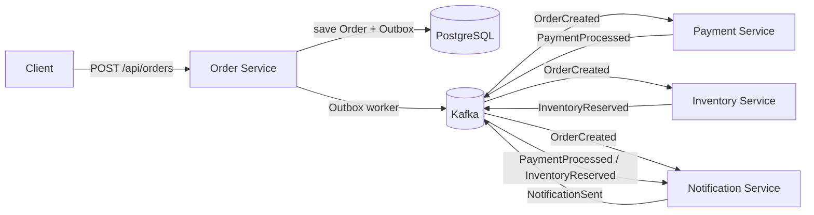
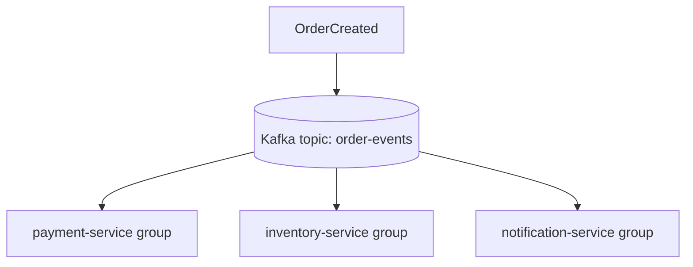
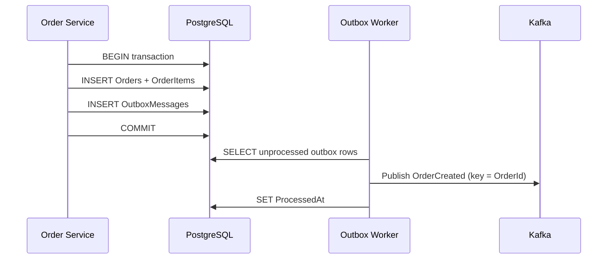

# Event-Driven Architecture Demo (.NET 8 + Kafka)

A complete, runnable **Order Processing** system that shows how independent .NET services communicate **asynchronously through Apache Kafka** — with no HTTP calls between services.

The demo is intentionally small, but it uses production practices: transactional outbox, at-least-once delivery with idempotency, retries with exponential backoff, and dead-letter queues.

## Architecture



Fan-out of `OrderCreated` (the core EDA demonstration):



Each consumer group independently receives every `OrderCreated` event. Payment and Inventory do not know about each other. Notification does not call Order Service.

### Outbox Pattern



The database write and the Kafka publish are **not** done in the same step. They are joined by the outbox table so a crash cannot persist an order without also persisting the event that other services need.

## Prerequisites

- [.NET 8 SDK](https://dotnet.microsoft.com/download/dotnet/8.0)
- [Docker](https://docs.docker.com/get-docker/) and Docker Compose

## Running the application

From the repository root:

```bash
docker compose up --build
```

This starts PostgreSQL, Kafka (KRaft, no ZooKeeper), creates topics, applies the Order Service EF Core migration on startup, and starts all four services.

| Service               | URL                                      |
|-----------------------|------------------------------------------|
| Order Service API     | http://localhost:5080                    |
| Swagger               | http://localhost:5080/swagger            |
| Health                | http://localhost:5080/health             |
| Payment health        | http://localhost:5081/health             |
| Inventory health      | http://localhost:5082/health             |
| Notification health   | http://localhost:5083/health             |

Wait until Order Service reports healthy, then create an order.

### Run services on the host instead

1. Start only infrastructure: `docker compose up postgres kafka kafka-init`
2. Apply migrations (optional if you run Order Service; it migrates on startup):

```bash
dotnet tool restore
dotnet ef database update --project src/OrderService --startup-project src/OrderService
```

If PostgreSQL was created before the extra databases existed, reset volumes once: `docker compose down -v`.

3. Run each service from `src/*` (`dotnet run`). Default ports are 5080–5083. Local `appsettings.json` already points at `localhost:9092` and `localhost:5433` (Docker Postgres is mapped to 5433 so it does not clash with a local PostgreSQL on 5432).

## Creating an order

```bash
curl -X POST http://localhost:5080/api/orders \
  -H "Content-Type: application/json" \
  -d "{
    \"customerId\": \"customer-001\",
    \"items\": [
      {
        \"productId\": \"product-001\",
        \"quantity\": 2,
        \"unitPrice\": 50.00
      }
    ]
  }"
```

Expected HTTP response:

```json
{
  "orderId": "3fa85f64-5717-4562-b3fc-2c963f66afa6",
  "status": "Created"
}
```

Retrieve it:

```bash
curl http://localhost:5080/api/orders/{orderId}
```

Order status stays `Created` on the Order Service. Downstream payment and inventory work is **eventually consistent** and is visible in the other services' logs, not via a synchronous callback.

## Expected logs

Follow one order by `OrderId` / `CorrelationId` / `EventId`. Every important log includes those properties plus the service name.

```
[OrderService]        OrderCreated OrderId=... CorrelationId=... EventId=...
[OrderService]        Outbox published EventType=OrderCreated Topic=order-events Key=...
[PaymentService]      Payment processing started OrderId=... CorrelationId=... EventId=...
[PaymentService]      Payment successful OrderId=...
[InventoryService]    Inventory reservation started OrderId=...
[InventoryService]    Inventory reserved OrderId=...
[NotificationService] Notification sent for Order ... (order created)
[NotificationService] Notification sent for Order ... (payment succeeded)
[NotificationService] Notification sent for Order ... (inventory reserved)
```

## Kafka topics

| Topic                    | Produced by            | Consumed by                                      | Purpose                                      |
|--------------------------|------------------------|--------------------------------------------------|----------------------------------------------|
| `order-events`           | Order Service (outbox) | Payment, Inventory, Notification                 | `OrderCreated` fan-out                       |
| `payment-events`         | Payment Service        | Notification                                     | `PaymentProcessed`                           |
| `inventory-events`       | Inventory Service      | Notification                                     | `InventoryReserved`                          |
| `notification-events`    | Notification Service   | (observable / future consumers)                  | `NotificationSent`                           |
| `order-events.dlq`       | any consumer of orders | operators                                        | poison / exhausted `OrderCreated` handling   |
| `payment-events.dlq`     | payment consumers      | operators                                        | exhausted payment-event handling             |
| `inventory-events.dlq`   | inventory consumers    | operators                                        | exhausted inventory-event handling           |
| `notification-events.dlq`| notification consumers | operators                                        | exhausted notification-event handling        |

Kafka message **key** is `OrderId` so all events for one order land on the same partition and stay ordered per order.

Wire format (camelCase JSON envelope):

```json
{
  "eventId": "guid",
  "eventType": "OrderCreated",
  "correlationId": "guid",
  "occurredAt": "2026-08-29T12:00:00Z",
  "payload": { }
}
```

## Consumer groups

| Group                   | Service                | Why it exists                                                                 |
|-------------------------|------------------------|-------------------------------------------------------------------------------|
| `payment-service`       | Payment Service        | Owns payment offsets. Scaling this group shares partitions, not duplicate work. |
| `inventory-service`     | Inventory Service      | Independent offsets, so inventory is not coupled to payment progress.          |
| `notification-service`  | Notification Service   | Independent offsets, so notifications can lag or go down without blocking others. |

If all three services used the **same** group, Kafka would load-balance `OrderCreated` across them and **each order would be seen by only one service**. Separate groups are what make the fan-out work.

## Retry and DLQ

Configured in `appsettings.json` / environment variables:

```json
{
  "Kafka": {
    "RetryCount": 3,
    "RetryDelaySeconds": 2
  }
}
```

If a handler throws:

1. Log `Processing failed.`
2. `Retry 1/3` — wait 2 seconds
3. `Retry 2/3` — wait 4 seconds
4. `Retry 3/3` — wait 8 seconds
5. Log `Moving message to DLQ.`
6. Publish the original payload plus the error to `{topic}.dlq`
7. Commit the original offset so the consumer moves on

Business simulation: Payment throws (and therefore retries → DLQ) when `TotalAmount` is greater than `Payment:FailForOrdersAbove` (default `10000`). Inventory throws when total quantity exceeds `Inventory:FailWhenTotalQuantityExceeds` (default `1000`).

## Idempotency

Kafka gives **at-least-once** delivery: a processed message may be delivered again after a crash. Each consumer writes `(EventId, ConsumerName)` to `ProcessedEvents` in its own PostgreSQL database.

```
Has this consumer already processed EventId?
    |
    +-- Yes --> Ignore and commit
    |
    +-- No ---> Process, then save EventId
```

A second delivery of the same `EventId` does not charge the card twice, does not reserve stock twice, and does not send a duplicate notification.

## Outbox Pattern

Order Service never publishes to Kafka from the HTTP request path.

1. Insert `Orders`, `OrderItems`, and `OutboxMessages` in **one EF Core `SaveChanges`** (one database transaction).
2. `OutboxPublisherWorker` polls unprocessed rows, publishes to Kafka, then sets `ProcessedAt`.

If Kafka is down, the order is still committed and the worker retries until the broker is available. If the process dies after Kafka ACK but before `ProcessedAt`, the event may be published twice — consumers' idempotency store handles that.

## Demo failure scenarios

### Scenario 1 — Normal flow

```bash
docker compose up --build
curl -X POST http://localhost:5080/api/orders -H "Content-Type: application/json" -d "{ \"customerId\": \"customer-001\", \"items\": [ { \"productId\": \"product-001\", \"quantity\": 2, \"unitPrice\": 50.00 } ] }"
docker compose logs -f payment-service inventory-service notification-service
```

You should see `OrderCreated` then `PaymentProcessed`, `InventoryReserved`, and `NotificationSent`.

### Scenario 2 — Notification service is down

```bash
docker compose stop notification-service
# create an order (same curl as above)
docker compose logs payment-service inventory-service   # these still work
docker compose start notification-service
docker compose logs -f notification-service             # pending Kafka messages are consumed
```

Payment and Inventory use different consumer groups, so they are unaffected. Notification resumes from its last committed offset (`auto.offset.reset=earliest` for a brand-new group).

### Scenario 3 — Payment failure → retry → DLQ

Create an order whose total is above 10000 (2 × 6000 = 12000):

```bash
curl -X POST http://localhost:5080/api/orders \
  -H "Content-Type: application/json" \
  -d "{
    \"customerId\": \"customer-001\",
    \"items\": [
      { \"productId\": \"product-001\", \"quantity\": 2, \"unitPrice\": 6000 }
    ]
  }"
```

Watch Payment Service:

```
Payment processing started ...
Payment failed ...
Processing failed.
Retry 1/3
Retry 2/3
Retry 3/3
Moving message to DLQ.
```

The original `OrderCreated` is copied to `order-events.dlq`. Inventory and Notification still receive the same `OrderCreated` — they are not blocked by payment.

### Scenario 4 — Duplicate event

Unit tests prove this without Kafka: `IdempotencyTests` marks an `EventId` as processed, then asserts a second check is skipped and a second insert is a no-op.

To see it in logs at runtime, the consumer prints:

```
Skipping already processed event EventId=... ConsumerName=payment-service
```

That path is hit when Kafka redelivers after a publish succeeded but the offset was not yet committed.

## EDA concepts demonstrated

| Concept                     | Where you see it                                                                 |
|----------------------------|----------------------------------------------------------------------------------|
| Event producer             | Order Service outbox worker; Payment / Inventory / Notification publishers       |
| Event consumer             | `ReliableKafkaConsumer` + each `*MessageHandler`                                 |
| Event broker               | Apache Kafka                                                                     |
| Asynchronous communication | HTTP returns `Created` before payment/inventory finish                           |
| Loose coupling             | No service-to-service HTTP; contracts live in `EdaDemo.Contracts`                |
| Consumer groups            | `payment-service`, `inventory-service`, `notification-service`                   |
| At-least-once delivery     | Manual commits after processing                                                  |
| Idempotency                | `ProcessedEvents` table per service                                              |
| Retry                      | `ExponentialBackoffRetryExecutor`                                                |
| Dead-letter queue          | `{topic}.dlq`                                                                    |
| Outbox Pattern             | `OutboxMessages` + `OutboxPublisherWorker`                                       |
| Eventual consistency       | Order status is `Created` immediately; other facts arrive as events              |
| Correlation IDs            | One `CorrelationId` flows through every event for an order                       |

## Tests

Unit tests do **not** require Kafka or PostgreSQL:

```bash
dotnet test EdaDemo.sln
```

Covered:

- Order creation and validation
- Event envelope JSON
- Outbox publishing
- Payment success / configured failure
- Inventory success / configured failure
- Idempotency store
- Retry + DLQ exhaustion logging

## Project layout

```
EdaDemo.sln
src/
  EdaDemo.Contracts/      # event records + envelope
  EdaDemo.Messaging/      # Kafka producer/consumer, retry, DLQ, idempotency
  OrderService/           # ASP.NET Core Web API
  PaymentService/         # worker (Kestrel only for /health)
  InventoryService/
  NotificationService/
tests/
  OrderService.Tests/
  PaymentService.Tests/
  InventoryService.Tests/
  EdaDemo.Contracts.Tests/
infrastructure/docker/    # Dockerfiles + Postgres init
docker-compose.yml
```

`EdaDemo.Messaging` keeps Kafka-specific code out of the business services. Handlers contain domain logic and are unit-tested with a fake `IEventPublisher`.

## Configuration

Nothing important is hard-coded. Docker Compose overrides the same keys with environment variables (`Kafka__BootstrapServers`, `ConnectionStrings__Default`, ...).

```json
{
  "Kafka": {
    "BootstrapServers": "localhost:9092",
    "RetryCount": 3,
    "RetryDelaySeconds": 2,
    "ConsumerGroup": "payment-service",
    "Topics": {
      "OrderEvents": "order-events",
      "PaymentEvents": "payment-events",
      "InventoryEvents": "inventory-events",
      "NotificationEvents": "notification-events"
    }
  },
  "Payment": {
    "FailForOrdersAbove": 10000
  }
}
```

Each worker uses its own PostgreSQL database on the same server: `orders`, `payments`, `inventory`, `notifications`.
